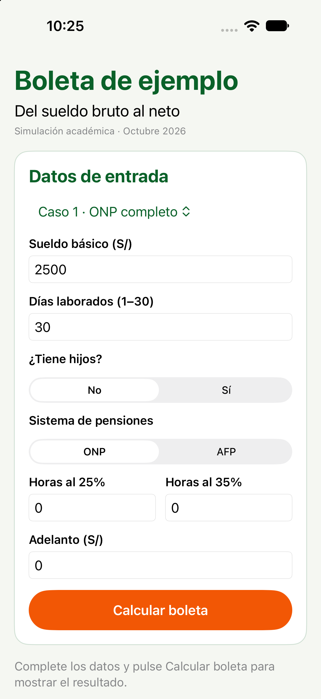
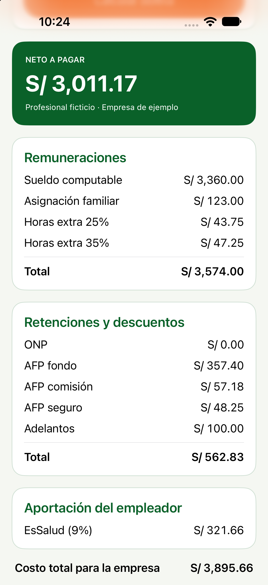
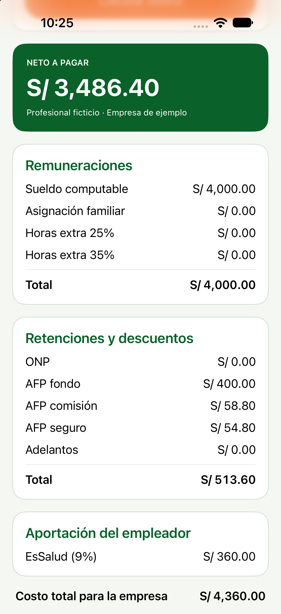
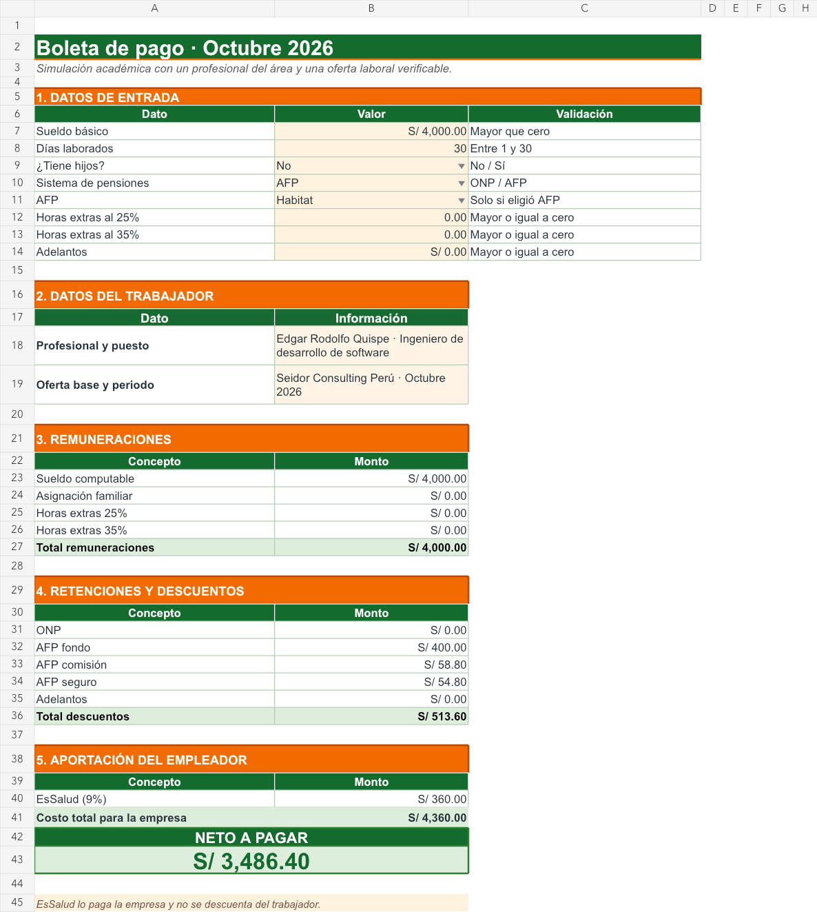
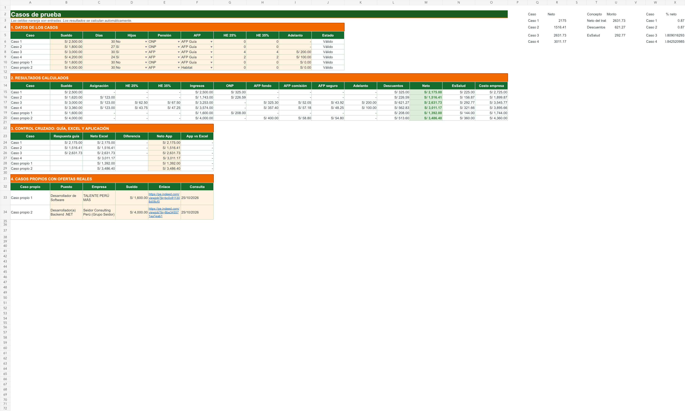

# Semana 9 · Boleta de pago

Aplicación de una sola pantalla desarrollada con SwiftUI. Permite ingresar los datos del trabajador, calcular remuneraciones, retenciones, descuentos, aportación de EsSalud y neto a pagar. El contenido es una simulación académica y no incluye datos sensibles.

## Estructura

- `BoletaPago/`: proyecto de Xcode.
- `BoletaPago/BoletaPago/Parametros.swift`: tasas y parámetros usados por todos los cálculos.
- `BoletaPago/BoletaPago/Modelos.swift`: estructuras de entrada y resultado.
- `BoletaPago/BoletaPago/Boleta.swift`: validaciones y fórmulas.
- `BoletaPago/BoletaPago/Casos.swift`: cuatro casos de la guía y dos casos propios.
- `BoletaPago/Pruebas/main.swift`: comprobación automática de los seis casos.
- `Excel/Boleta_Pago_Grupo_B.xlsx`: Excel con fórmulas, explicación, fuentes, gráficos y control cruzado.
- `evidencias/`: capturas de la aplicación y del Excel.

## Resultados verificados

| Caso | Neto Excel | Neto aplicación | Diferencia |
|---|---:|---:|---:|
| Caso 1 | S/ 2,175.00 | S/ 2,175.00 | S/ 0.00 |
| Caso 2 | S/ 1,516.41 | S/ 1,516.41 | S/ 0.00 |
| Caso 3 | S/ 2,631.73 | S/ 2,631.73 | S/ 0.00 |
| Caso 4 | S/ 3,011.17 | S/ 3,011.17 | S/ 0.00 |
| Caso propio 1 | S/ 1,392.00 | S/ 1,392.00 | S/ 0.00 |
| Caso propio 2 | S/ 3,486.40 | S/ 3,486.40 | S/ 0.00 |

Cada concepto monetario se redondea a dos decimales antes de calcular los totales. Los datos inválidos muestran un mensaje y no generan una boleta.

## Abrir el proyecto

```bash
cd /Users/andy_luis/Documents/MOVILES_AVANZADOS_CAMPOS
git switch manual
open SEMANA09/BoletaPago/BoletaPago.xcodeproj
```

## Ejecutar las pruebas

```bash
cd /Users/andy_luis/Documents/MOVILES_AVANZADOS_CAMPOS
swiftc \
  SEMANA09/BoletaPago/BoletaPago/Parametros.swift \
  SEMANA09/BoletaPago/BoletaPago/Modelos.swift \
  SEMANA09/BoletaPago/BoletaPago/Boleta.swift \
  SEMANA09/BoletaPago/BoletaPago/Casos.swift \
  SEMANA09/BoletaPago/Pruebas/main.swift \
  -o /tmp/semana09_boleta_pruebas
/tmp/semana09_boleta_pruebas
```

## Evidencias

### Formulario en iPhone



### Caso 4 revisado por la guía



### Caso propio con oferta laboral



### Boleta en Excel



### Control cruzado entre guía, Excel y aplicación


